## 🎮 Ficha de personaje

| | |
|---|---|
| **Clase** | Ingeniera en Sistemas de Información |
| **Base** | Córdoba, Argentina |

## 🎒 Inventario

## 🗺️ Misiones

| Nivel | Misión | Stack | Código |
|---|---|---|---|
| **1** | **Memotest**: juego de memoria con ranking Top 5 | React, Vite, Express | [Repo](https://github.com/luciaduarte12/memotest-db) |
| **2** | **Soporte de Tickets**: análisis de 300 tickets con clasificación por IA y dashboard interactivo | Python, Gemini API, Power BI, Tableau Public | [Repo](https://github.com/luciaduarte12/analisis-tickets-soporte-ia) |
| **👑 Jefe final** | **Gestión de Flotas**: microservicios para mantenimiento preventivo | Java 17, Spring Boot, RabbitMQ, PostgreSQL, React | [Repo](https://github.com/luciaduarte12/gestion-flotas-microservicios) |

## 🏆 Logros desbloqueados

## 🐍 Etapa bonus

<img src="https://raw.githubusercontent.com/luciaduarte12/luciaduarte12/output/github-snake.s
